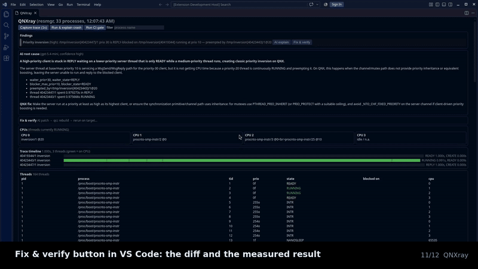
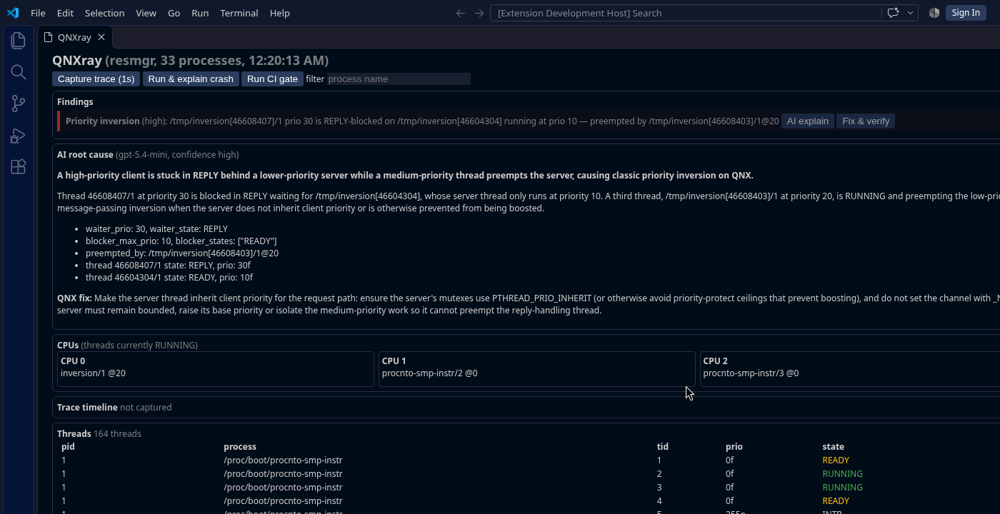
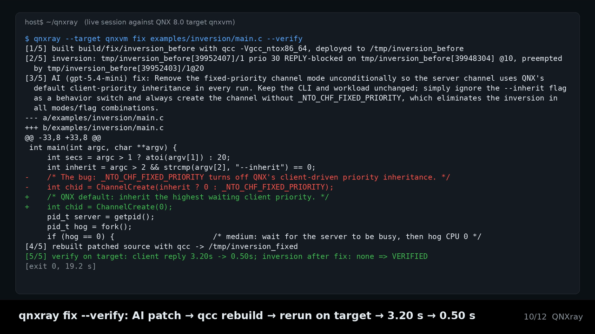
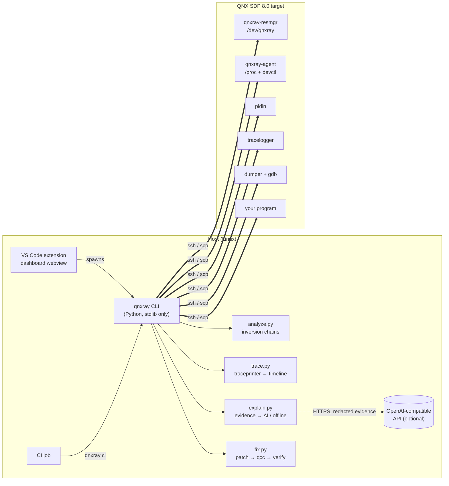

<h1 align="center">QNXray</h1>
<p align="center"><b>An X-ray for QNX 8.0 scheduling.</b><br>
Automatic priority-inversion detection · CI gating · AI root cause · fixes verified on the target.</p>

<p align="center">


</p>

<p align="center"></p>

A priority-30 thread asks a server for a 0.5 s reply and waits **3.2 s**. Nothing crashes, nothing is logged.
On a real-time system that is a bug you cannot see.

**QNXray finds it by itself** on a live QNX 8.0 target by following message-passing chains, **fails the CI
build** on it, has an **AI model explain the root cause** from real QNX evidence (thread states, the
inversion chain, a `tracelogger` timeline, backtraces), and **`qnxray fix --verify`** applies the AI's patch,
rebuilds it with `qcc`, reruns it on the target and measures the result: **3.20 s → 0.50 s, verified**.

Demo video (2:47): [`demo/qnxray_demo.mp4`](demo/qnxray_demo.mp4) · script: [`demo/STORYBOARD.md`](demo/STORYBOARD.md)

---

## Contents
[Features](#features) · [Quick start](#quick-start) · [Why QNXray](#why-not-just-use-the-qnx-momenticsvs-code-toolkit) ·
[Architecture](#architecture) · [CLI](#cli-reference) · [VS Code](#vs-code) · [CI](#ci) · [AI explainer](#ai-explainer) ·
[Fix & verify](#fix--verify) · [Troubleshooting](#troubleshooting) · [Roadmap](#roadmap) · [License](#license)

## Features
| | |
|---|---|
| 🔍 **Live snapshot** | Every process/thread on the target (state, priority, policy, blocked-on, CPU) from `pidin`, an on-target agent (`/proc` + `devctl`), or QNXray's own resource manager **`/dev/qnxray`**. |
| ⚠️ **Inversion detection** | Follows SEND/REPLY chains and names the waiter, the server it is blocked on, and the thread preempting that server, with a severity. |
| 📈 **Kernel-trace proof** | `tracelogger` capture → `traceprinter` → per-thread timeline (time RUNNING / READY / REPLY). |
| 🤖 **AI root cause** | Inversions and crashes explained from structured evidence; JSON-validated; QNX-specific fix and patch; offline rules when no key. |
| 🛠️ **Fix & verify** | AI patch → `qcc` rebuild → rerun on target → before/after latency + unified diff. |
| 🚦 **CI gate** | `qnxray ci`: exit `0` clean, `1` crash, `2` inversion, `3` both; JSON report; `--fix` writes the patch. |
| 💥 **Crash explainer** | Deploys and runs a binary, collects the `dumper` core, symbolizes it with gdb, explains it with file and line. |
| 🧩 **VS Code dashboard** | Live findings, AI root cause, Fix & verify, per-CPU lanes, trace timeline, thread table. |

<table><tr>
<td></td>
<td></td>
</tr><tr>
<td align="center">VS Code dashboard: live finding + AI root cause</td>
<td align="center"><code>qnxray fix --verify</code>: 3.20 s → 0.50 s, VERIFIED</td>
</tr></table>

## Quick start
No QNX target yet? Everything except building and live capture works against a built-in **mock** target:
```bash
git clone https://github.com/suganthikannan093-hue/qnxray.git && cd qnxray
export PYTHONPATH=$PWD/cli                       # stdlib-only Python, nothing to install
python3 -m qnxray --target mock snapshot | head
python3 -m qnxray --target mock inversions --no-ai
```
On a real QNX SDP 8.0 target (QEMU or hardware, see [docs/GETTING_STARTED.md](docs/GETTING_STARTED.md)):
```bash
source ~/qnx800/qnxsdp-env.sh                    # qcc, traceprinter; then set PYTHONPATH (the script resets it)
export PYTHONPATH=$PWD/cli QNXRAY_TARGET=qnxvm   # ssh alias of your target
mkdir -p build && qcc -Vgcc_ntox86_64 -g -o build/inversion examples/inversion/main.c
scp build/inversion qnxvm:/tmp/ && ssh qnxvm '(sudo -n /tmp/inversion 30 &)'
python3 -m qnxray inversions --explain --trace   # detect + AI root cause
python3 -m qnxray fix examples/inversion/main.c --verify
```
Or install the command: `pip install ./cli` → `qnxray ...`.

## Why not just use the QNX Momentics/VS Code toolkit?
The official tools are excellent for interactive debugging and trace viewing; QNXray adds the automated
layer on top. Every "official" cell below is taken from the linked QNX SDP 8.0 documentation.

| Need | QNX Momentics IDE / QNX Toolkit for VS Code (official docs) | QNXray |
|---|---|---|
| Find a priority inversion | Manual: capture a `.kev` trace, filter the Timeline to the threads you suspect, zoom to the slow interval "to within a few milliseconds", search events and read the sequence yourself ([Momentics: Detecting priority inversion](https://www.qnx.com/developers/docs/8.0/com.qnx.doc.ide.userguide/topic/detecting_priority_inversion.html)) | **Automatic**: follows the `MsgSend`/REPLY chain on every live snapshot and names waiter, blocked server and preempting thread (`qnxray inversions`) |
| Trace analysis in VS Code | System Profiler views (Event Table, Timeline, Event Density, CPU Usage) for viewing/filtering a trace ([Toolkit: Using the System Profiler](https://www.qnx.com/developers/docs/8.0/com.qnx.doc.qnxtoolkit.user_guide/topic/using_the_system_profiler.html)); the Toolkit's own transition guide lists "limited functionality for viewing results" ([Transitioning from Momentics IDE](https://www.qnx.com/developers/docs/8.0/com.qnx.doc.qnxtoolkit.user_guide/topic/transition_guide_for_momentics_ide.html)) | tracelogger capture decoded into a per-thread timeline and attached as **evidence** to the finding |
| Fail a CI build on an inversion | No pass/fail inversion check is described in the docs above (analysis is interactive) | `qnxray ci`: exit 2 = inversion, 1 = crash, 0 = clean, JSON report; headless over ssh |
| Crash post-mortem in VS Code | Postmortem core-file debugging "isn't supported" in the Toolkit; a manual `launch.json` workaround is documented ([Toolkit: Launching an application](https://www.qnx.com/developers/docs/8.0/com.qnx.doc.qnxtoolkit.user_guide/topic/launching_an_application.html)). Momentics can download and open the core in GDB ([Momentics: Debugging a core file](https://www.qnx.com/developers/docs/8.0/com.qnx.doc.ide.userguide/topic/debugging_postmortem.html)) | Runs the binary, collects the dumper core, extracts the backtrace and explains it (one command, also in CI) |
| Root-cause explanation | Not described in the docs above (you interpret the trace / debugger state) | **AI root cause** from structured evidence, JSON-validated, with a QNX-specific fix; offline rules when no key |
| Fix and prove it | Not described in the docs above | **`qnxray fix --verify`**: AI patch → `qcc` rebuild → rerun on the target → measured before/after + diff |

QNXray complements the official tools: use Momentics/System Profiler for deep manual dives; use QNXray to
catch, explain and fix the inversion automatically, and to keep it from coming back in CI.

## Architecture

Details: [docs/ARCHITECTURE.md](docs/ARCHITECTURE.md).

## CLI reference
`qnxray [--target mock|ALIAS|[user@]host[:port]] [--source pidin|agent|resmgr] COMMAND`

| Command | What it does |
|---|---|
| `snapshot` | One JSON snapshot of all processes/threads |
| `watch [--interval S] [--count N]` | NDJSON stream of snapshots (used by the dashboard) |
| `inversions [--explain] [--trace] [--no-ai]` | Detect inversions; JSON with `explanation`, or human-readable AI root cause with `--explain` |
| `explain-crash BINARY [--remote] [--json]` | Deploy + run, collect core, explain the crash |
| `timeline [--seconds S] [--run CMD] [--match NAME] [--kev FILE] [--json]` | tracelogger capture → per-thread timeline |
| `ci [--run BIN] [--background 'BIN ARGS'] [--seconds S] [--report FILE] [--fix SRC] [--fix-out FILE]` | CI gate (exit codes below) |
| `fix SOURCE [--verify] [--args A] [--patch-out FILE] [--json]` | AI fix for a live inversion; with `--verify`, rebuild/rerun/measure |
| `build SOURCE` | `qcc` build of a `.c` file or a directory with `main.c` |

Full reference with every option, environment variable and output format: [docs/CLI.md](docs/CLI.md).

## VS Code
`cd extension && npm install && npm run package` → `code --install-extension qnxray-0.1.0.vsix` (the CLI is bundled).
Set `qnxray.target` (e.g. `qnxvm`), run **QNXray: Open Scheduling Dashboard**. Each finding has **AI explain** and
**Fix & verify** buttons. Commands, settings and screenshots: [docs/VSCODE.md](docs/VSCODE.md).

## CI
```bash
qnxray --target qnxvm ci --background 'build/inversion 15' --run build/crashy \
       --seconds 5 --report qnxray-report.json --fix examples/inversion/main.c --fix-out qnxray-fix.patch
```
| Exit code | Meaning |
|---|---|
| `0` | clean: no crash, no inversion |
| `1` | a `--run` binary crashed |
| `2` | a priority inversion was observed |
| `3` | both |

GitHub Actions / GitLab examples and the report schema: [docs/CI.md](docs/CI.md).

## AI explainer
| Variable | Default | Purpose |
|---|---|---|
| `QNXRAY_LLM_KEY` | – | API key (falls back to `OPENAI_API_KEY`). Environment only. |
| `QNXRAY_LLM_URL` | `https://api.openai.com/v1/chat/completions` | Any OpenAI-compatible endpoint |
| `QNXRAY_LLM_MODEL` | `gpt-5.4-mini` | Model name |
| `QNXRAY_LLM_TIMEOUT` | `90` | Seconds |
| `QNXRAY_LLM=off` | – | Force offline rules |

**Data & privacy.** Only structured debugging evidence is sent: for crashes the signal, backtrace, the last 800
bytes of stderr and ±6 source lines around the fault; for inversions the waiter/owner/preemptor chain, the involved
threads' states and priorities, and an optional timeline; for `fix` additionally **the full text of the source
file being fixed**. Strings and fields that look like keys, tokens or passwords are redacted first. Nothing is
sent when no key is set. The key is never written to reports, settings, logs or the repo.
Replies must be valid JSON of a fixed shape; anything else falls back to offline rules, so CI never depends on
the network. More: [docs/AI.md](docs/AI.md).

## Fix & verify
```text
$ qnxray --target qnxvm fix examples/inversion/main.c --verify
[1/5] built build/fix/inversion_before with qcc -Vgcc_ntox86_64, deployed to /tmp/inversion_before
[2/5] inversion: inversion_before[…]/1 prio 30 REPLY-blocked on inversion_before[…] @10, preempted by inversion_before[…]/1@20
[3/5] AI (gpt-5.4-mini) fix: Remove the fixed-priority channel attribute so the server channel uses QNX's default client-priority inheritance …
--- a/examples/inversion/main.c
+++ b/examples/inversion/main.c
-    int chid = ChannelCreate(inherit ? 0 : _NTO_CHF_FIXED_PRIORITY);
+    int chid = ChannelCreate(0);
[4/5] rebuilt patched source with qcc -> /tmp/inversion_fixed
[5/5] verify on target: client reply 3.20s -> 0.50s; inversion after fix: none => VERIFIED
```
(excerpt of [`examples/fixtures/ai_fix_verify.txt`](examples/fixtures/ai_fix_verify.txt), a real run.)
Safety: an AI edit is applied only if it matches the source exactly once and the result passes a QNX lint
(no `_NTO_CHF_FIXED_PRIORITY` left in a `ChannelCreate`); otherwise the built-in offline fix is used. The
original file is never modified; the patched copy lives in `build/fix/`. See [docs/AI.md](docs/AI.md#fix--verify).

## Troubleshooting
| Symptom | Fix |
|---|---|
| `QNX SDP env not sourced` | `source ~/qnx800/qnxsdp-env.sh`, then re-export `PYTHONPATH=$PWD/cli` (the script resets it) |
| `traceprinter not found` | Source the SDP env, or set `QNXRAY_TRACEPRINTER=/path/to/traceprinter` |
| Snapshot shows only your own processes | QNX secure procfs: QNXray runs `pidin`/agent via `sudo -n`; add a NOPASSWD sudoers rule on the target (or `QNXRAY_SUDO=0` when logged in as root) |
| `--source resmgr` fails | Start it on the target: `sudo -n /tmp/qnxray-resmgr` (serves `/dev/qnxray`) |
| No core file for `explain-crash` | The target must run `dumper` (the quick-start image writes `~/cores/<name>.core`) |
| AI output says `offline` | No key in the environment, `QNXRAY_LLM=off`, or the reply was invalid (see `ai_error` in the JSON) |
| Dashboard blank | Check the **QNXray** output channel; confirm `qnxray.python` and `qnxray.target` |
More in [docs/GETTING_STARTED.md](docs/GETTING_STARTED.md#troubleshooting).

## Roadmap
- Raspberry Pi 4 (aarch64) validation on hardware (`QNXRAY_QCC_VARIANT=gcc_ntoaarch64le` already supported for builds).
- Mutex-based inversion detection (`PTHREAD_PRIO_INHERIT` / `PRIO_PROTECT`) in addition to message passing.
- Timeline lanes for multi-CPU traces in the dashboard; `.kev` import from the System Profiler.
- `fix --verify` for arbitrary programs via a user-supplied latency probe.
- Marketplace packaging of the extension.

## Repository layout
`agent/` on-target C (agent + resource manager) · `cli/` Python CLI and tests · `extension/` VS Code extension ·
`examples/` demo programs and real AI fixtures · `scripts/` QEMU boot, SDP install, live smoke test ·
`demo/` video pipeline · `docs/` documentation.

Contributing: [CONTRIBUTING.md](CONTRIBUTING.md) · Changes: [CHANGELOG.md](CHANGELOG.md)

## License
[MIT](LICENSE). Built and tested with QNX SDP 8.0 under the free non-commercial QNX Everywhere licence.
