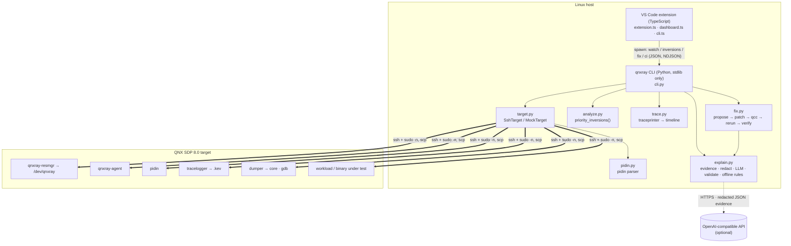

# Architecture

## Components
| Component | File(s) | Role |
|---|---|---|
| Resource manager | `agent/qnxray-resmgr.c` | Registers `/dev/qnxray` with `resmgr_attach`; each `open`+`read` returns a fresh JSON snapshot (extended OCB holds the buffer; `iofunc_*`, `dispatch_*`) |
| Agent | `agent/qnxray-agent.c` | Walks `/proc`, `devctl(DCMD_PROC_INFO)` per process and `DCMD_PROC_TIDSTATUS` per thread → JSON (also linked into the resmgr) |
| Target layer | `cli/qnxray/target.py` | ssh/scp, `sudo -n`, snapshot sources (`pidin` / `agent` / `resmgr`), deploy, run & capture crash (dumper core + gdb backtrace), tracelogger capture |
| Mock | `cli/qnxray/mock.py` | Deterministic simulated target with an inversion and a crash; used by tests and offline demos |
| Model | `cli/qnxray/model.py`, `pidin.py` | Snapshot/Process/Thread dataclasses; `pidin` parser |
| Analysis | `cli/qnxray/analyze.py` | For each MUTEX/SEND/REPLY-blocked thread, follows `blocked_on` to the owner process; flags it when all owner threads run below the waiter (no inheritance). A RUNNING/READY thread with a priority in between is `preempted_by` → severity `high`, otherwise `medium` |
| Trace | `cli/qnxray/trace.py` | Decodes `traceprinter` output into per-thread RUNNING/READY/REPLY time and intervals |
| Explainer | `cli/qnxray/explain.py` | Builds evidence, redacts, calls the LLM, validates JSON, offline rules, fix proposal + lint |
| Fix & verify | `cli/qnxray/fix.py` | Build/deploy before, detect, propose, diff, rebuild, rerun, measure, rescan |
| CLI | `cli/qnxray/cli.py` | argparse commands, CI gate and report |
| Extension | `extension/src/*.ts` | Commands, settings, webview dashboard; CLI bundled into `extension/cli` at package time |

## Data flow: an inversion, end to end
1. `watch` polls a snapshot (via `/dev/qnxray`, the agent or `pidin`) every `interval`.
2. `priority_inversions()` reports `waiter → owner (server) ← preempted_by`.
3. `inversions --trace` captures 1 s of `tracelogger` and adds the owner's timeline.
4. `inversion_evidence()` → `redact()` → LLM (or offline) → validated explanation.
5. `fix --verify` asks for exact-match edits, lints, rebuilds with `qcc`, reruns and compares `reply after Xs`.
6. `ci` aggregates findings into a report and an exit code.

## Target-side interfaces (QNX 8.0 docs)
| Data | Interface | Doc |
|---|---|---|
| process/thread list, prio+policy, state, blocked-on | `pidin` | https://www.qnx.com/developers/docs/8.0/com.qnx.doc.neutrino.utilities/topic/p/pidin.html |
| per-process info | `/proc/<pid>/ctl` + `devctl(DCMD_PROC_INFO)` | https://www.qnx.com/developers/docs/8.0/com.qnx.doc.neutrino.prog/topic/process_DCMD_PROC_INFO.html |
| per-thread status | `devctl(DCMD_PROC_TIDSTATUS)` | https://qnx.com/developers/docs/8.0/com.qnx.doc.neutrino.prog/topic/process_proc_filesystem.html |
| kernel events | `tracelogger` → `.kev` (root, instrumented procnto) | https://www.qnx.com/developers/docs/8.0/com.qnx.doc.neutrino.utilities/topic/t/tracelogger.html |
| crashes | `dumper` | https://www.qnx.com/developers/docs/8.0/com.qnx.doc.neutrino.utilities/topic/d/dumper.html |
| QEMU image tooling | `mkqnximage` | https://www.qnx.com/developers/docs/8.0/com.qnx.doc.neutrino.utilities/topic/m/mkqnximage.html |

The `/proc` documentation describes it as a debugging interface; QNXray is a development-time tool, which matches.

## Design choices
- **Stdlib-only Python** so the CLI runs on any CI runner and is bundled into the extension without a venv.
- **Three snapshot sources** so it works on a stock image (`pidin`) and, faster and structured, with the agent/resmgr.
- **AI is optional and validated**: evidence in, fixed JSON shape out, offline fallback; patches must match exactly and pass a QNX lint.
- **Never modify user sources**: patched copies live in `build/fix/`.
