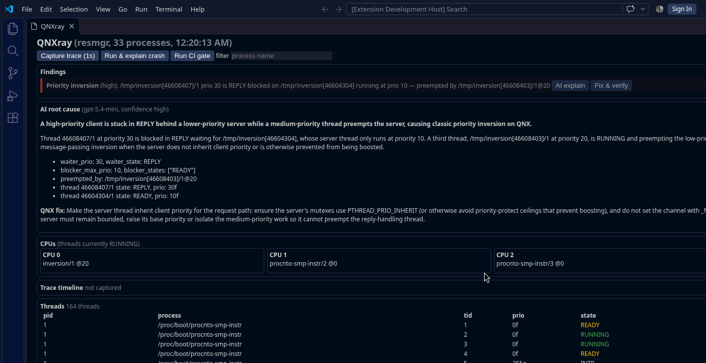
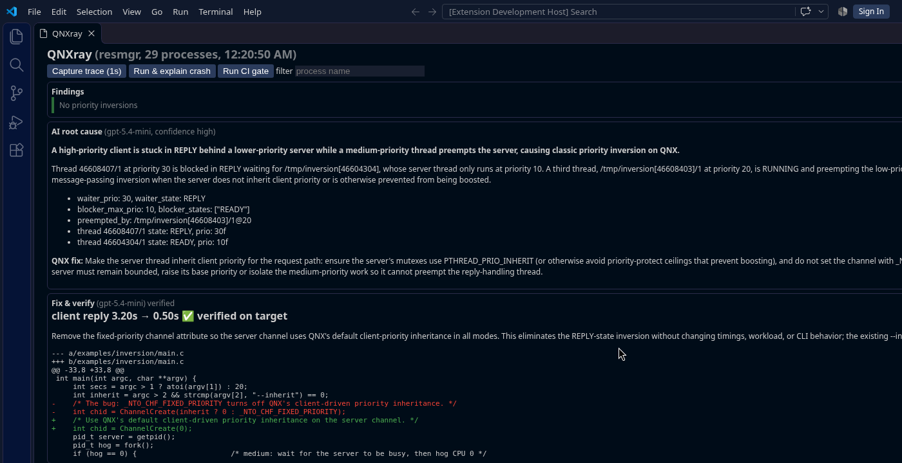

# VS Code extension

The extension bundles the CLI and drives it; the dashboard is a webview fed by `qnxray watch` (NDJSON).

## Install
```bash
cd extension && npm install && npm run package      # -> qnxray-0.1.0.vsix (CLI bundled)
code --install-extension qnxray-0.1.0.vsix
```
For **Build**, **Fix & verify** and trace capture, launch VS Code from a shell that has sourced
`~/qnx800/qnxsdp-env.sh` (the CLI needs `QNX_TARGET`/`QNX_HOST` for `qcc` and `traceprinter`). Put the AI key in
that shell's environment too; the extension never reads it from settings.

Development: open `extension/`, `npm run compile`, press F5 (Extension Development Host).
After changing the CLI run `node scripts/bundle-cli.js` to refresh the bundled copy.

## Commands (Command Palette)
| Command | ID | What it does |
|---|---|---|
| QNXray: Open Scheduling Dashboard | `qnxray.openDashboard` | Live dashboard |
| QNXray: AI explain priority inversion | `qnxray.explainInversion` | `inversions --trace` → AI root cause card |
| QNXray: Fix & verify priority inversion | `qnxray.fixVerify` | `fix SRC --verify --json` on `qnxray.fixSource` or the active editor's file |
| QNXray: Capture Trace Timeline | `qnxray.timeline` | 1 s `tracelogger` capture, optional name filter |
| QNXray: Explain Last Crash | `qnxray.explainCrash` | Pick a binary, run it on the target, show the explained crash |
| QNXray: Run CI Gate | `qnxray.ci` | `ci --seconds 3`, pass/fail notification |
| QNXray: Build Current File for QNX | `qnxray.build` | `qcc` build of the active C file |

## Settings
| Setting | Default | Meaning |
|---|---|---|
| `qnxray.target` | `mock` | `mock`, an ssh alias (e.g. `qnxvm`) or `[user@]host[:port]` |
| `qnxray.source` | `""` (pidin) | `pidin`, `agent` or `resmgr` (`/dev/qnxray`) |
| `qnxray.interval` | `1` | Dashboard refresh, seconds |
| `qnxray.python` | `python3` | Python interpreter |
| `qnxray.fixSource` | `""` | C file Fix & verify patches (default: active editor) |
| `qnxray.llmModel` | `""` | Overrides `QNXRAY_LLM_MODEL` |

## Dashboard


- **Header**: source, process count, last refresh; buttons *Capture trace (1s)*, *Run & explain crash*, *Run CI gate*; process filter.
- **Findings**: each inversion with severity and **AI explain** / **Fix & verify** buttons.
- **AI root cause**: summary, explanation, evidence bullets, QNX fix (model and confidence in the title).
- **Fix & verify**: the measured `client reply X → Y ✅ verified on target` line, rationale and the coloured diff.
- **CPUs**: threads currently RUNNING per CPU. **Trace timeline**: per-thread bars (green = on CPU). **Threads**: full table.



Output and errors go to the **QNXray** output channel.

## Automated test
`node out/test/runTest.js` opens the dashboard against `QNXRAY_TARGET` (default mock) and exercises the commands;
`QNXRAY_EXPECT_INVERSION=1` asserts a live inversion and `QNXRAY_FIX_SOURCE=<file>` runs Fix & verify and asserts
`verified`.
